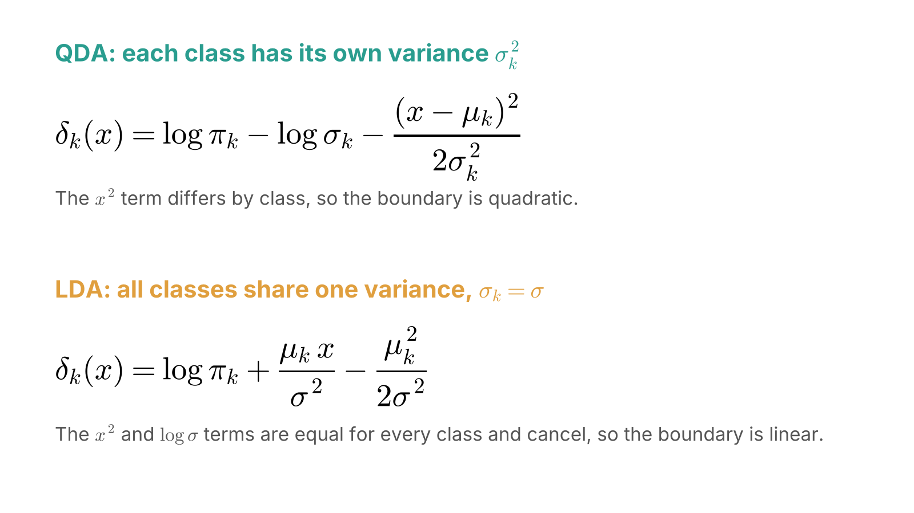
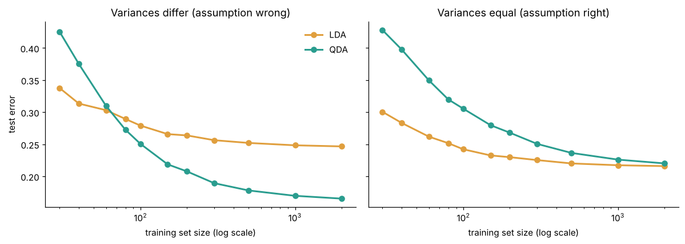

# LDA vs QDA: bias and variance

LDA assumes every class shares the same variance (σ_k = σ). That assumption cancels the x² and log σ_k terms in the discriminant and gives a linear boundary. If the assumption is true, nothing is lost. If the class variances really differ, the shared σ introduces bias. In exchange, LDA estimates far fewer parameters, so it has lower variance.

This notebook shows both sides with simulations.

1. **1D example.** The true boundary has two thresholds and LDA can only draw one.
2. **10D example, unequal variances.** LDA wins on small samples, QDA wins once there is enough data, and LDA plateaus above the Bayes error.
3. **10D control, equal variances.** The assumption holds, LDA has no bias, and it wins at every sample size.

## Run it

Requires numpy, scipy, matplotlib and scikit-learn (all preinstalled on Colab). Runs in about a minute.
